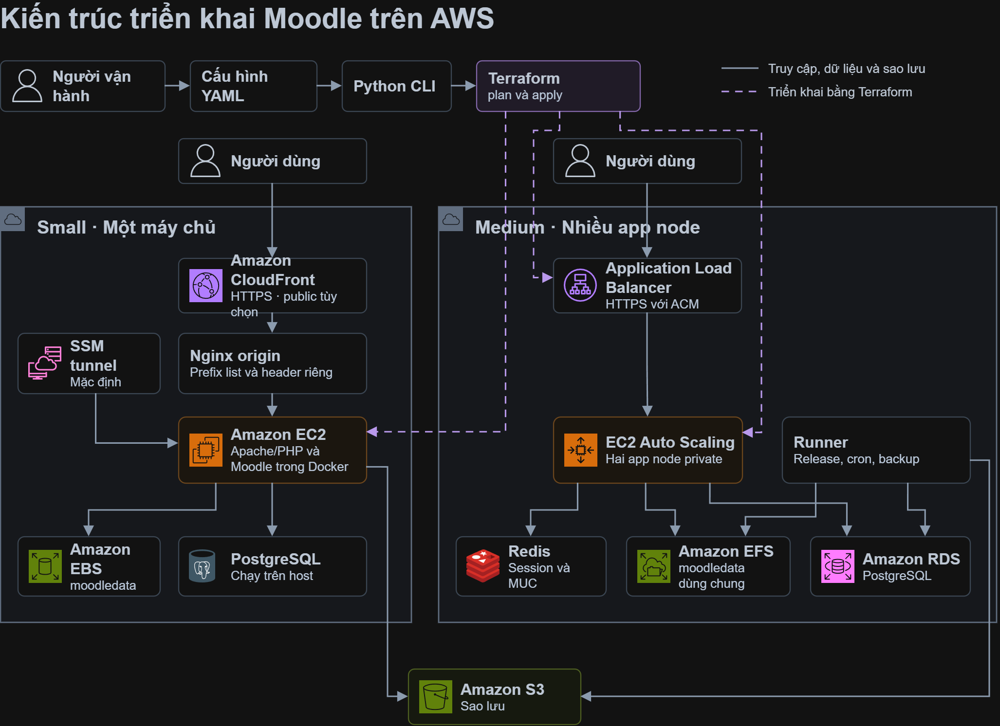

# Moodle Cloud Distribution

Công cụ triển khai và vận hành **Moodle Learning Management System trên Amazon Web Services**, sử dụng **Terraform**, **Python CLI** và cấu hình **YAML**. Dự án hỗ trợ mô hình một máy chủ (**small**) và mô hình nhiều máy ứng dụng (**medium**), cùng quy trình kiểm tra, sao lưu và phục hồi dữ liệu.


## Truy cập demo

**Moodle small public:** [https://d1cnnw3mivc0q5.cloudfront.net](https://d1cnnw3mivc0q5.cloudfront.net)

**Moodle medium public:** [https://www.moodle-cloud-distribution.mywire.org](https://www.moodle-cloud-distribution.mywire.org) — [vận hành và nghiệm thu medium Sydney](docs/21-medium-sydney.md). URL CloudFront cũ giữ lại và chuyển hướng sang tên miền.

Mở trực tiếp bằng trình duyệt, không cần localhost hoặc SSM tunnel. Sử dụng tài khoản được nhóm bàn giao qua kênh riêng; mật khẩu không được công bố trong README.

Hai demo Sydney hiện dùng chung ba username **`admin`**, **`teacher`**, **`student`** và mật khẩu tương ứng. Đã kiểm tra cả sáu lượt đăng nhập HTTPS; mỗi site giữ khóa học, dữ liệu và phiên đăng nhập riêng.

Demo minh họa luồng **đăng nhập → khóa học → học liệu → bài nộp → điểm và phản hồi**. Xem [kịch bản demo](docs/15-small-demo.md) và [hướng dẫn small public](docs/20-small-public.md).

Small dev Sydney đang dùng CloudFront HTTPS; staging giữ truy cập qua SSM. Khả dụng của demo phụ thuộc lịch giữ/dừng tài nguyên của nhóm.

Medium có policy tự mở rộng **2–3 app**, đã quan sát chu kỳ **2→3→2** với target 200 request/app/phút, dashboard CloudWatch và **14 cảnh báo vận hành**. Luồng **ALARM → SNS/SQS → OK** đã được thử thực tế. Tên miền dùng HTTPS/ACM trực tiếp tại ALB; **47/47 kiểm tra nghiệp vụ** sau chuyển đổi đạt. [Bằng chứng mới và giới hạn](docs/evidence/current-review-2026-11-15/README.md).

## Kiến trúc hệ thống



| Thành phần | Small | Medium |
|---|---|---|
| Compute | Một EC2 Ubuntu, EBS gp3 mã hóa | Hai app node, ASG và runner riêng |
| Database | PostgreSQL 16 trên cùng host | RDS PostgreSQL Single-AZ |
| Dữ liệu Moodle | `moodledata` trên EBS, ngoài webroot | EFS dùng chung |
| Session/cache | Runtime của một máy | Redis tách session và MUC |
| Truy cập | SSM mặc định; addon CloudFront cho URL public | ALB HTTPS/ACM; CloudFront là tùy chọn lab |
| Terraform state | Local, tách project/environment | S3 backend, versioning và lockfile |

Lab Sydney dùng tên miền Dynu với HTTPS/ACM trực tiếp tại ALB, hai app private và runner riêng; URL CloudFront cũ chuyển hướng sang tên miền. Small có một điểm lỗi duy nhất; medium vẫn có các điểm lỗi đơn ở database, cache và NAT. Xem [thiết kế kiến trúc](docs/02-architecture.md) và [cấu hình live](docs/21-medium-sydney.md).

## Tính năng

### Học tập và quản lý khóa học

Các chức năng học tập sử dụng **Moodle chuẩn** và theme Boost:

- Đăng nhập/đăng xuất, phân quyền admin, teacher và student.
- Tạo khóa học, gán giảng viên và ghi danh học viên.
- Đăng học liệu, upload/download file theo quyền truy cập.
- Nộp bài, chấm điểm và xem phản hồi riêng của từng học viên.
- Chạy Moodle scheduled/ad hoc tasks thông qua cron.

### Triển khai và quản lý cấu hình

- Chọn preset small hoặc medium bằng YAML.
- Kiểm tra trường bắt buộc, kiểu dữ liệu, khóa trùng/lạ và cấu hình ngoài phạm vi.
- Kiểm tra AWS account và prerequisite trước khi triển khai.
- Lưu Terraform plan, đối chiếu source/config/account/hash trước apply.
- Tách state theo môi trường; medium có backend dùng chung và khóa.
- Theo dõi SSM command đến trạng thái cuối bằng `--wait`.

### Sao lưu và phục hồi

- Sao lưu nhất quán database và `moodledata` bằng cách chặn writer và chờ cron.
- Lưu checksum, manifest cùng tham chiếu code/runtime.
- Backup local hoặc S3 theo preset/cấu hình.
- Từ chối backup hỏng hoặc thiếu file trước khi restore.
- Restore vào staging với xác nhận đích và nguy cơ mất dữ liệu.

### Truy cập public và mở rộng

- Small có addon CloudFront HTTPS, cache tắt cho Moodle và origin được giới hạn truy cập.
- Medium tách app, database, file và session để chạy nhiều node.
- Release/migration medium chạy trên runner, không chạy đồng thời trên từng app.
- Có workload JMeter, công cụ thu metric và hồ sơ nghiệm thu.

Large, production HA, giao diện tạo site một nút, tự chọn cấu hình theo số người dùng và tự cài plugin ngoài chưa được hỗ trợ.

## Công nghệ sử dụng

### Ứng dụng và công cụ

| Công nghệ | Vai trò |
|---|---|
| Moodle 4.5.15 | LMS và chức năng học tập |
| Apache + PHP 8.3, OPcache | Web runtime trong Docker |
| PostgreSQL 16 | Database |
| Python ≥3.11, PyYAML | CLI, schema và công cụ kiểm tra |
| Terraform ≥1.10,<2; AWS provider 6.x | Infrastructure as Code |
| Docker | Đóng gói runtime và kiểm thử tích hợp |
| systemd timers | Lập lịch cron và backup trên host/runner |
| Apache JMeter | Kiểm thử tải |
| GitHub Actions | Kiểm tra source, runtime và Terraform |

### Hạ tầng AWS

| Dịch vụ | Vai trò |
|---|---|
| EC2, EBS, VPC, IAM | Compute, storage và phân quyền |
| Systems Manager | Quản trị, Run Command và tunnel |
| S3 | Backup, artifact và state medium |
| CloudFront | URL Amazon HTTPS cho small public hoặc medium lab |
| Secrets Manager | Secret medium và origin credential của small public |
| ALB, ACM, ASG | HTTPS và nhiều app node medium |
| RDS, EFS, ElastiCache Redis | Database, file và trạng thái dùng chung medium |
| CloudWatch, AWS Budgets | Log/metric/alarm và theo dõi ngân sách theo cấu hình |

Baseline host là **Ubuntu Server 26.04**; PHP chạy trong container. Chi tiết lựa chọn và giới hạn phiên bản nằm trong [ADR công nghệ](docs/01-version-decisions.md).

## Yêu cầu chuẩn bị

Để kiểm tra cấu hình và chạy unit tests:

- Python 3.11 trở lên.
- Dependency trong [requirements.txt](requirements.txt).

Để triển khai và vận hành AWS:

- Terraform ≥1.10,<2 và AWS CLI v2.
- Phiên AWS hợp lệ, đúng account/region và quyền cho các dịch vụ cần dùng.
- Session Manager plugin cho small preflight và truy cập SSM.
- Docker Linux engine nếu build/test runtime cục bộ.
- Domain/DNS và ACM cho medium dùng HTTPS trực tiếp tại ALB.

`aws login` yêu cầu AWS CLI ≥2.32.0. Không lưu AWS access key, mật khẩu hoặc token trong YAML/repository.

## Bắt đầu sử dụng

### 1. Clone repository

```bash
git clone https://github.com/iamquan24122006/BTL-Cloud.git
cd BTL-Cloud
```

### 2. Chuẩn bị Python

PowerShell tại thư mục repository:

```powershell
python -m venv .venv
$Py = if (Test-Path '.venv/Scripts/python.exe') {
    (Resolve-Path '.venv/Scripts/python.exe').Path
} else {
    (Resolve-Path '.venv/bin/python.exe').Path
}
& $Py -m pip install -r requirements.txt
```

Python Windows thường tạo `.venv/Scripts/`; MSYS2 có thể tạo `.venv/bin/`. Linux/macOS dùng `.venv/bin/python`. Nếu đã có virtualenv hợp lệ, có thể dùng lại; không sao chép virtualenv giữa các máy.

### 3. Chọn cấu hình và kiểm tra offline

```powershell
& $Py -m src.moodle_cloud --config config/sydney.yaml validate
& $Py -m src.moodle_cloud --config config/medium.example.yaml validate
& $Py -m unittest discover -s tests -v
```

Các lệnh trên không tạo tài nguyên AWS. YAML medium mẫu chứa placeholder, không dùng nguyên trạng để deploy.

### 4. Kết nối AWS

Ví dụ cho profile lab Sydney hiện có:

```powershell
$env:AWS_PROFILE = 'moodle-project'
$Config = 'config/sydney.yaml'
$ExpectedAccount = '<ACCOUNT_ID_CUA_LAB>'

aws sts get-caller-identity --region ap-southeast-2
# Khi cần đăng nhập lại, hoàn tất xác thực trên trình duyệt:
aws login --profile moodle-project --region ap-southeast-2

& $Py -m src.moodle_cloud doctor
& $Py -m src.moodle_cloud --config $Config preflight --expected-account $ExpectedAccount
```

Điền account nhóm đã xác nhận. Với lab/account khác, dùng profile, YAML và state riêng. `doctor` kiểm tra tool; preflight không chứng nhận toàn bộ quyền tạo/sửa tài nguyên.

## Cấu hình

### Các file YAML

| File | Mục đích |
|---|---|
| [config/dev.yaml](config/dev.yaml) | Mẫu small để tham khảo cho lab riêng |
| [config/sydney.yaml](config/sydney.yaml) | Small dev Sydney hiện có |
| [config/sydney-staging.yaml](config/sydney-staging.yaml) | Small staging Sydney |
| [config/medium.example.yaml](config/medium.example.yaml) | Schema mẫu medium, cần thay identifiers |

Ví dụ cấu hình cho một small lab mới:

```yaml
project: team-lms
environment: dev
region: ap-southeast-2
size: small
instance_type: t3.small
volume_gib: 30
moodle_version: "4.5.15"
wwwroot: http://localhost:8080
backup_bucket: ""
tags:
  Purpose: coursework
```

Lưu thành file riêng, ví dụ `config/team-lms.yaml`, rồi truyền đường dẫn qua `--config`. `backup_bucket` rỗng chỉ tạo backup local, dữ liệu đó sẽ mất nếu volume bị hủy; muốn backup S3 phải chuẩn bị bucket/quyền phù hợp.

### Các tham số chính

| Tham số | Ý nghĩa |
|---|---|
| `project`, `environment` | Tên tài nguyên và môi trường `dev`/`staging` |
| `region`, `size` | Region triển khai và preset `small`/`medium` |
| `instance_type`, `volume_gib` | Loại T3 hỗ trợ và dung lượng EBS |
| `moodle_version` | Hiện ghim `4.5.15` |
| `wwwroot` | Small bootstrap dùng localhost; medium theo frontend |
| `backup_bucket`, `tags` | Tham chiếu bucket và metadata |
| `account_id`, `backend` | Account/backend medium |
| `frontend`, `domain`, `certificate_arn` | Endpoint HTTPS medium |
| `artifact`, `ami_id`, `secrets` | Release, AMI và secret reference medium |
| `db_backup_retention_days` | RDS automated backup 1–35 ngày, mặc định 7; lab Free Plan hiện dùng 1 |

Small public được bật bằng addon riêng, giữ YAML bootstrap gốc để tránh thay user-data/EC2 chỉ vì đổi URL. Runtime marker giúp CLI báo URL public và giữ SG origin khi render. Xem [runbook small public](docs/20-small-public.md).

## Tham chiếu CLI

Dự án cung cấp CLI quản trị hạ tầng; không có bộ REST API riêng do nhóm xây dựng.

| Lệnh `python -m src.moodle_cloud` | Chức năng |
|---|---|
| `doctor` | Kiểm tra tool trên máy |
| `--config <yaml> validate` / `render` | Kiểm tra YAML / sinh tfvars offline |
| `--config <yaml> preflight` | Kiểm tra account và prerequisite; small cần `--expected-account` |
| `--config <yaml> plan` | Tạo saved plan và bản tóm tắt thay đổi |
| `--config <yaml> apply --confirm <project>-<environment>` | Áp dụng plan đã kiểm tra |
| `--config <yaml> status` | Đọc outputs; có URL public nếu addon được kích hoạt |
| `--config <yaml> health --wait` | Đợi kết quả health trên máy đích |
| `--config <yaml> backup --wait` | Backup và đợi trạng thái cuối |
| `--config <yaml> command-status --command-id <id> --wait` | Theo dõi SSM command |
| `--config <yaml> restore ...` | Restore staging với các chốt xác nhận |
| `--config <yaml> plan --destroy` / `destroy ...` | Lập và áp dụng kế hoạch dọn dẹp |

Dùng `--help` cho cú pháp đầy đủ. `status` không thay thế health hoặc nghiệm thu nghiệp vụ; timeout/pending không được tính là thao tác thành công.

## Ví dụ sử dụng

### Kiểm tra site và backup

```powershell
& $Py -m src.moodle_cloud --config $Config status
& $Py -m src.moodle_cloud --config $Config health --wait
& $Py -m src.moodle_cloud --config $Config backup --wait
```

Backup thành công chưa có nghĩa chính bộ đó đã restore-test. Quy trình phục hồi database và file nằm trong [runbook vận hành](docs/05-operations.md).

### Quản lý frontend small public

```powershell
& $Py -m scripts.small_public --config $Config --expected-account $ExpectedAccount status

# Với small đã dựng, chưa có frontend public:
& $Py -m scripts.small_public --config $Config --expected-account $ExpectedAccount plan
# Review saved plan trước khi apply.
& $Py -m scripts.small_public --config $Config --expected-account $ExpectedAccount apply --confirm moodle-sydney-dev
```

Đổi `--confirm` theo đúng project/environment khi dùng YAML khác. Small dev hiện đã có frontend, không cần tạo lại để mở demo. Lệnh `activate` dùng để retry bước cấu hình host sau partial failure; `disable` dùng rollback về SSM. [Chi tiết và cleanup addon](docs/20-small-public.md).

## Kiểm thử

```powershell
& $Py -m unittest discover -s tests -v
& $Py -m scripts.check_runtime
& $Py -m scripts.check_moodle
```

Hai lệnh sau cần Docker Linux engine. Runtime check kiểm tra PHP/Apache; Moodle check kiểm tra cài ứng dụng và backup/restore bằng dữ liệu giả. Medium có bộ integration hai app riêng trong `scripts.check_medium_runtime`.

[GitHub Actions](.github/workflows/validate.yml) chạy unit tests, schema/bundle, Bash/PHP checks, runtime small/medium và Terraform validate/mock tests. Workflow không deploy AWS.

| Bộ kiểm tra | Kết quả được ghi nhận |
|---|---|
| Thay đổi small public hiện tại | 95 unit tests, 2 small Terraform mock tests đạt |
| Small public live | HTTPS, login các role, học liệu/hash, bài nộp/điểm, privacy, logout và origin protection đạt |
| Medium release local | Build từ checkout sạch và integration hai app đạt |
| Medium Sydney live | 47/47 ca HTTPS trên nguồn và 47/47 sau restore vào RDS/EFS mới; session/file/cache xuyên node, khóa chung, cron, backup và ASG replacement đạt |
| CI `93bdc8b` | [Success](https://github.com/iamquan24122006/BTL-Cloud/actions/runs/43605256815); 96 unit tests, runtime small/medium, backup/restore local và Terraform checks |

Kết quả đo tải và giới hạn workload: [ma trận Sydney](docs/evidence/final-audit-2026-11-14/README.md), [hồ sơ N3](docs/evidence/aws-n3-2026-11-11/README.md). Không gộp số liệu khác account/commit hoặc suy sức tải tối đa từ một lượt đo.

## Cấu trúc dự án

```text
BTL-Cloud/
├── config/                  YAML theo môi trường
├── src/                     Python CLI và schema medium
├── infra/
│   ├── small/               VPC, IAM, EC2 và EBS
│   ├── small_public/        CloudFront và origin access cho small
│   ├── medium/              ALB/ASG, RDS, EFS, Redis, runner
│   ├── medium_support/      Bucket, ECR và secret metadata
│   ├── medium_builder/      Máy build AMI medium
│   ├── backend/             S3 backend
│   ├── backup/              Bucket/chính sách backup small
│   └── budget/              Budget và cảnh báo
├── scripts/                 Bootstrap, runtime, vận hành, demo
├── tests/                   Unit, integration fixture và JMeter
├── docs/                    Thiết kế, runbook, báo cáo và evidence
└── .github/workflows/       CI
```

`.work/` chứa state, saved plan, log và artifact riêng tư; không commit.

## Bảo mật

- Xác nhận AWS account và target trước thao tác; dùng IAM role/credential chain.
- Không lưu mật khẩu, token, private key hoặc giá trị secret trong YAML/Git.
- Saved plan chỉ dùng một lần; từ chối khi source/config/account/hash thay đổi.
- Nhận diện EC2 replacement và nguy cơ mất dữ liệu trước apply.
- Mã/config Moodle chỉ đọc với web user; `moodledata` nằm ngoài webroot.
- Small public dùng HTTPS viewer, cookie Secure/HttpOnly, cache disabled và origin prefix list + private header.
- Restore staging yêu cầu exact confirm và `--allow-data-loss`.

Small public kết thúc TLS tại CloudFront, chặng tới nginx origin dùng HTTP được giới hạn truy cập; chưa phải TLS đầu cuối. Không suy lab small/medium là hệ thống production đã harden hoặc có SLA.

## Triển khai AWS

### Small

```powershell
& $Py -m src.moodle_cloud --config $Config plan
# Review account, tài nguyên tạo/sửa/xóa/thay thế và chi phí.
& $Py -m src.moodle_cloud --config $Config apply --confirm moodle-sydney-dev
& $Py -m src.moodle_cloud --config $Config health --wait
```

`apply` tạo tài nguyên có phí. Thay AMI/bootstrap/user-data có thể thay EC2 và xóa DB/file trên root volume; cần backup đã kiểm chứng và review plan. Không chạy lại các lệnh triển khai chỉ để mở site demo đang có. [Hướng dẫn small](docs/04-deployment.md).

### Medium

Lab Sydney dùng tên miền HTTPS, hai app và runner `t3.small`, RDS PostgreSQL 16.13, EFS và hai Redis riêng. YAML thật trên máy triển khai là `.work/medium-sydney-live/medium.yaml`, đã đồng bộ `frontend: acm`, `retain_cloudfront: true` và target scaling 200; không chứa mật khẩu. [Runbook live, giới hạn Free Plan và chi phí](docs/21-medium-sydney.md).

Thực hiện theo [runbook medium](docs/10-medium-n2.md): chuẩn bị backend/bucket/ECR/secret, build AMI và artifact ghim digest, điền YAML thật, chạy preflight/plan/apply, release trên runner rồi nghiệm thu site. Chỉ Terraform apply xong chưa có nghĩa Moodle đã ready.

Medium từng dùng **`www.moodle-cloud-distribution.mywire.org`**, DNS tại Dynu, HTTPS trực tiếp ALB. Lab N2 đã cleanup; DNS còn trỏ tới ALB cũ không tồn tại tại lần đối chiếu. Có thể dùng lại hostname khi có quyền DNS và cập nhật certificate/origin mới; không dùng nguyên ARN/AMI/URL lịch sử để tái triển khai. [Hồ sơ domain](docs/13-medium-med02.md), [cleanup](docs/15-aws-cleanup.md).

### Dọn dẹp

Backup và xác minh dữ liệu cần giữ trước khi review saved destroy plan. Đối chiếu bucket, snapshot, public IP, network và tài nguyên ngoài state. Rollback ứng dụng không đồng nghĩa đã xóa hạ tầng/ngừng mọi chi phí. Public addon có root/state riêng; không destroy small để chỉ gỡ URL public.

## Giám sát và vận hành

| Thành phần | Cách kiểm tra |
|---|---|
| Ứng dụng | `health --wait` và bộ nghiệm thu nghiệp vụ |
| Host | Cloud-init, Docker/systemd và SSM |
| Cron | Timer, lần task thực sự chạy, failure/backlog |
| Backup | Service/SSM status, checksum, manifest S3 và restore drill |
| Medium | Readiness, runner operation log, CloudWatch log/metric/alarm |
| Chi phí | AWS Budgets, Cost Explorer và inventory theo từng account |

Không chỉ dựa vào timer active hoặc HTTP 200. Backup mới không tự được coi đã restore-test; budget không tự dừng tài nguyên. [Vận hành](docs/05-operations.md), [chi phí và demo](docs/07-report-and-cost.md).
