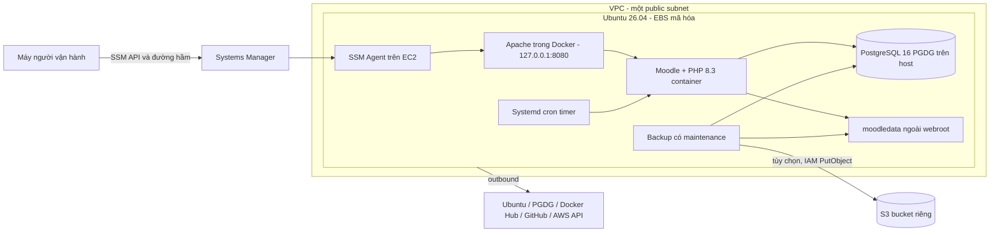
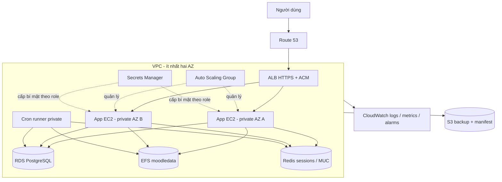

# Kiến trúc và kế hoạch mở rộng

## 1. Small — đã có mã Terraform

Tài nguyên Terraform: một VPC, subnet, Internet Gateway, route table/association, SG không ingress, IAM role/profile, quyền SSM, quyền ghi prefix backup nếu có, một EC2. EBS root gp3 được mã hóa và xóa cùng instance. Không có RDS, ALB, NAT Gateway, EFS hay Redis trong small.

Systemd quản lý container web và lịch cron trên host. PHP CLI dùng cùng image ID với web, chạy UID/GID 33:33; DB và dữ liệu nằm trên EBS của host, bind mount vào container theo nhu cầu. Apache dùng host network nhưng chỉ nghe loopback. Backup dừng `moodle-web.service`, chờ cron hoàn tất rồi đọc DB/file trên host.

Giới hạn: một AZ, một máy, không HA; DB và file cùng mất nếu root volume mất; IP public vẫn tính phí dù web không public. Credential khởi tạo tại `/root/moodle-initial-admin.txt`, đổi sau khi đăng nhập.

## 2. Medium — P1, đã có mã và chờ nghiệm thu AWS

Mã P1 nằm trong `infra/medium/`, `scripts/medium/` và CLI schema medium. Cấu hình lab gồm 2 app node, 1 runner, RDS Single-AZ, EFS, hai Redis riêng cho session/MUC, ALB ở 2 AZ và ASG tối đa 3 app. Một NAT dùng cho cửa sổ lab và vẫn là điểm lỗi đơn. [Hướng dẫn N2](10-medium-n2.md) là quy trình triển khai hiện tại; các phần kiến trúc dự kiến dưới đây cần đọc cùng quyết định hiện thực trong hướng dẫn đó. Chưa có bằng chứng nghiệm thu AWS cho medium.

App và DB không có public IP; ALB dùng public subnet. Private app cần NAT hoặc VPC endpoints phù hợp để lấy secret, SSM, log và artifact. Endpoints không thay đường Internet tới Ubuntu/GitHub; dùng AMI đã build giúp giảm phụ thuộc bootstrap và thời gian scale-out.

## 3. Hợp đồng module khi triển khai P1

| Module | Đầu vào chính | Đầu ra chính | Nghiệm thu |
|---|---|---|---|
| network | CIDR, AZ, subnet CIDR, kiểu egress | VPC/subnet IDs | Hai AZ, route đúng, DB không route Internet |
| database | engine/version, subnet, app SG, Multi-AZ | Endpoint/port, secret ARN | Không public, TLS, app role quyền DB giới hạn |
| storage | VPC, app SG, UID/GID, backup policy | EFS ID/access point, bucket reference | Mount TLS; ghi A/đọc B; ownership thống nhất |
| cache | engine tương thích, subnet, SG, failover | Redis endpoints, secret ARN | TLS/auth, session qua hai app; MUC mapping kiểm riêng |
| compute | AMI, subnet, target group, endpoints/secrets | ASG, launch template, cron runner | Node mới tự ready; node lỗi được thay |
| loadbalancer | public subnet, certificate ARN, app SG | HTTPS endpoint/target group | HTTP redirect HTTPS, health phản ánh app |
| observability | resource IDs, log group/retention | Dashboard/alarm IDs | Có CPU/RAM/disk/5xx/cron/backup alarm |

## 4. Ma trận kết nối P1

| Nguồn | Đích | Port | Quy tắc |
|---|---|---|---|
| Internet | ALB | TCP 443; 80 chỉ redirect | Public entry point |
| SG ALB | SG App | TCP 80 hoặc port app đã chọn | Chỉ nhận từ ALB |
| SG App + Cron | SG DB | TCP 5432 | Không dùng CIDR Internet |
| SG App + Cron | SG EFS | TCP 2049 | Mount targets ở các AZ app |
| SG App + Cron | SG Redis | Port endpoint, thường 6379 | TLS và xác thực |
| App/Cron | AWS endpoints / egress | TCP 443 | Theo nhu cầu SSM, secret, log, artifact |

## 5. Các điểm phải xử lý trước khi bật ASG

- Code cùng một release trên mọi node, nằm local trong AMI. Migration database chỉ chạy trong release job có khóa, không chạy ở mọi user-data.
- `moodledata` chia sẻ qua EFS. `$CFG->localcachedir` đặt trên mỗi node; không tự chuyển mọi thư mục cache/temp sang local khi chưa hiểu yêu cầu chia sẻ.
- Redis session handler và Moodle Universal Cache là hai cấu hình riêng. Cài Redis PHP extension không tự cấu hình MUC.
- Mọi cron/app runner dùng cơ chế khóa tương thích. Nếu backend khóa dùng filesystem thì phải thực sự dùng chung; không để mỗi máy có một lock độc lập.
- ALB dùng HTTPS ngoài, HTTP nội bộ có kiểm soát; đặt `wwwroot` đúng HTTPS và kiểm tra các thiết lập proxy Moodle theo cấu trúc proxy thực tế. Thử login, redirect, upload lớn và logout.
- Không dùng sticky session để che lỗi session dùng chung. Khi thay node hoặc phân phối request sang node khác, login và file vẫn phải hoạt động.
- CloudFront là tùy chọn sau khi có baseline. Không cache tùy tiện trang cá nhân, quiz, session hoặc file yêu cầu xác thực.
- Kiểm tra file nhỏ và độ trễ EFS bằng workload thật. EFS có overhead mỗi thao tác; tránh coi dung lượng lớn là đủ chứng minh IOPS. [EFS performance tips](https://docs.aws.amazon.com/efs/latest/ug/performance-tips.html)

## 6. Large — mục tiêu thiết kế P2

| Thuộc tính | Small | Medium dự kiến | Large dự kiến |
|---|---|---|---|
| App | 1 EC2 | ASG 2–4 node | ASG theo đo tải |
| Database | Local PG16 | RDS cùng major tương thích | RDS Multi-AZ |
| File | EBS local | EFS Regional | EFS Regional + backup/restore drill |
| Sessions/cache | Cơ chế mặc định single-node | Redis dùng chung | Redis replication/failover đã thử |
| Cron | Timer trên app | Runner riêng | Runner/worker và khóa phân tán |
| HA | Không | Phụ thuộc DB/cache/egress | Đánh giá tất cả phụ thuộc theo AZ |
| Mục tiêu tải thử | 10/25/50 đồng thời | 50/100/200 đồng thời | Tăng dần theo số đo |

50/500/5.000 tài khoản được đăng ký không tương đương 50/500/5.000 người đang thi đồng thời. Các con số trên chỉ là ma trận thử nghiệm đề xuất, không phải thông số năng lực của instance.

Với loại **RDS Multi-AZ DB instance một standby**, standby phục vụ failover, không nhận truy vấn đọc từ ứng dụng. Cần phân biệt với read replica và Multi-AZ DB cluster. [Tài liệu RDS](https://docs.aws.amazon.com/AmazonRDS/latest/UserGuide/Concepts.MultiAZSingleStandby.html)
