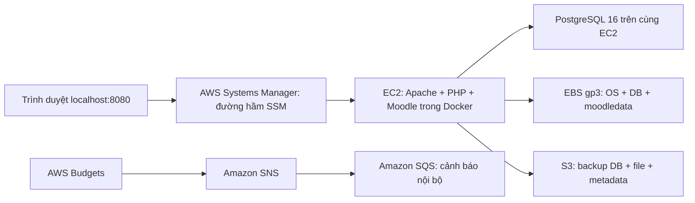

# Dịch vụ sử dụng trong Small

Danh sách này phản ánh Terraform và hồ sơ kiểm chứng của lab Sydney. Dev và staging có cấu hình riêng; trạng thái đang chạy cần kiểm tra bằng inventory AWS trước demo. Staging là môi trường phục hồi/kiểm thử, không phải node dự phòng HA.

## Dịch vụ AWS đã sử dụng

| Dịch vụ | Vai trò thực tế | Cách minh họa |
|---|---|---|
| **Amazon EC2** | Một `t3.small` x86_64 cho mỗi môi trường; Ubuntu Server 26.04; chạy ứng dụng, DB và systemd timers trên cùng máy | EC2 Console: instance type, tags dev/staging, IMDSv2 required, CPU credits standard |
| **Amazon EBS** | Root volume gp3 30 GiB mã hóa mỗi EC2, chứa OS, PostgreSQL, `moodledata` và backup cục bộ; xóa cùng instance khi terminate | Tab Storage của EC2: gp3, 30 GiB, encrypted |
| **Amazon VPC** | VPC, public subnet, Internet Gateway, route table, Security Group; IPv4 public để máy tải package và gọi AWS API ra ngoài | SG core không ingress; route `0.0.0.0/0` qua IGW; không NAT Gateway trong small |
| **AWS IAM** | EC2 instance role/profile cho SSM; inline policy ghi S3 giới hạn prefix riêng của môi trường; người vận hành dùng profile đăng nhập | IAM instance profile trên EC2 và phạm vi bucket/prefix trong Terraform |
| **AWS Systems Manager** | Session Manager mở shell/port forwarding; Run Command chạy health, acceptance, backup và thu bằng chứng | SSM managed node Online, command history, tunnel `localhost:8080` |
| **Amazon S3** | Bucket backup riêng, chặn public access, AES256/SSE-S3, versioning; retention object hiện hành 14 ngày và noncurrent 7 ngày; còn lưu artifact kiểm thử riêng tư | Danh sách bộ timestamp/tám file, Properties/Permissions; không trình chiếu nội dung secret |
| **Amazon CloudWatch** | Đọc EC2 metrics có sẵn như CPUUtilization/CPUCreditBalance để đối chiếu bài tải | EC2 Monitoring/CloudWatch; metric OS/DB chi tiết do script thu, log ứng dụng ở máy chủ |
| **AWS Budgets** | Budget `moodle-sydney-small-202611`, 150 USD kỳ tháng 11/2026; scope toàn account, usage trước credit/refund; actual >75% và forecast >100% | Budget Console và cấu hình notification |
| **Amazon SNS** | Nhận thông báo budget và chuyển vào SQS | Topic/subscription nội bộ đã kiểm thử gửi/nhận nonce |
| **Amazon SQS** | Queue nhận cảnh báo nội bộ, mã hóa SSE-SQS, retention 7 ngày; chưa có email recipient | Queue và report xác minh kênh; không cần phát thông báo thử khi demo |
| **AWS Cost Explorer** | Đọc chi phí usage/credit theo kỳ để làm sổ chi phí; số Estimated có thể cập nhật | Bảng chi phí có cửa sổ ngày và scope rõ ràng; không coi credit bù usage là không phát sinh chi phí |
| **AWS STS** | `GetCallerIdentity` xác minh account/identity trước khi thao tác | Lệnh preflight/STS, che thông tin định danh nếu quay video công khai |

Budget là kênh cảnh báo, không phải trần chi tiêu cưỡng chế. Tổng ngân sách đồ án là 150 USD xuyên kỳ; không tự đặt lại tiền còn lại khi sang tháng. S3 và EBS còn lưu vẫn có thể phát sinh phí sau khi stop EC2.

## Phần mềm và công cụ

| Thành phần | Vai trò |
|---|---|
| Moodle 4.5.15, theme Boost | LMS: khóa học, enrolment, tài liệu, bài nộp, điểm và phân quyền |
| Docker, Apache, PHP 8.3 + OPcache | Runtime web/PHP; CLI/cron/health dùng chung image với web |
| PostgreSQL 16 | Database tự quản lý trên EC2, không phải Amazon RDS |
| systemd, cron runner | Khởi động web, lịch task Moodle và lịch backup; không dùng EventBridge/Lambda để chạy cron |
| Terraform + AWS provider | Tạo hạ tầng, outputs, plan/apply/destroy có kiểm soát; state local riêng trong `.work/` |
| Python + PyYAML | CLI đọc YAML, kiểm tra cấu hình, gọi Terraform/AWS CLI; script health/acceptance/metric/backup verification |
| AWS CLI + Session Manager plugin | Điều khiển AWS và mở đường hầm demo |
| Apache JMeter + Java | Phát tải giả 10/25/50 user; generator EC2 riêng chỉ phục vụ kiểm thử |
| Git/GitHub Actions | Quản lý source, CI unit/integration/lint/Terraform mock tests |

Các dịch vụ RDS, EFS, ElastiCache/Redis, ALB, Auto Scaling, NAT Gateway, Route 53, ACM, CloudFront, ECS/EKS, Lambda và Secrets Manager chưa thuộc triển khai small này. Medium/large mới là hướng thiết kế; một EC2 small vẫn là điểm lỗi đơn. Kiểm tra chi tiết ở [kiến trúc](02-architecture.md), [chi phí](07-report-and-cost.md) và [nghiệm thu](13-small-acceptance.md).
