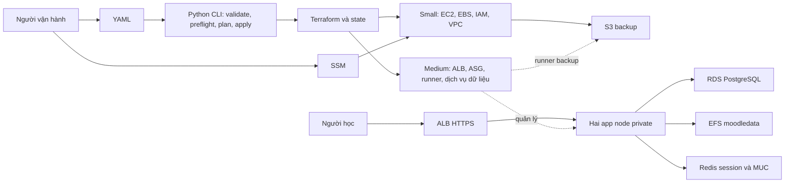

# Báo cáo đồ án: Triển khai và vận hành Moodle LMS trên AWS

**Phiên bản tổng hợp:** 14/11/2026. **Nhóm:** 4 thành viên. **Ngân sách toàn dự án:** 150 USD. Tên, mã sinh viên, lớp và người hướng dẫn do nhóm bổ sung khi đưa vào mẫu nộp của môn học.

## Tóm tắt

Đồ án xây dựng một công cụ triển khai Moodle LMS trên Amazon Web Services bằng Terraform, Python CLI và cấu hình YAML. Hệ thống hỗ trợ hai preset: small dùng một EC2 cho web, database và dữ liệu; medium tách các app node, database, lưu trữ và cache. Đóng góp của nhóm nằm ở quy trình dựng hạ tầng, kiểm tra cấu hình, quản lý thay đổi, vận hành và phục hồi dữ liệu; chức năng học tập sử dụng Moodle chuẩn.

Source tích hợp `2130963` đã qua CI đầy đủ. Ngày 14/11, Moodle small Sydney trên dev và staging vượt qua kiểm tra chức năng, cron và toàn vẹn backup. Hồ sơ medium trước đó chứng minh HTTPS tại ALB, hoạt động nhiều node và restore vào cluster riêng. Ma trận tải Sydney có đủ ba lượt cho mỗi mức 10, 25 và 50 người dùng; kết quả và giới hạn được trình bày riêng với ma trận N3 ở account khác. Báo cáo không tuyên bố production HA, SLA hoặc hoàn tất các tiêu chí chưa có bằng chứng.

## 1. Bài toán, mục tiêu và phạm vi

Cài Moodle thủ công đòi hỏi phối hợp hệ điều hành, PHP, web server, database, quyền file và cron. Khi mở rộng số app node, session, cache, file và khóa thao tác phải nhất quán giữa các máy. Việc sao lưu cũng phải bảo đảm database và `moodledata` cùng một điểm dừng ghi để dữ liệu khôi phục không bị lệch.

Ba câu hỏi thực nghiệm của đồ án là: có dựng được môi trường theo cấu hình thống nhất; có phục hồi đầy đủ học liệu, bài nộp và điểm; và tải tăng tác động thế nào đến độ trễ, tài nguyên và chi phí.

Phạm vi P0 là small, CLI/IaC, cài từng bước, chức năng Moodle, cron, backup/restore và đo tải. P1 là medium với ALB/ASG, RDS, EFS, Redis, runner và state chung có khóa. Large, HA toàn bộ phụ thuộc, tự nâng cấp production, plugin ngoài, SSO và ứng dụng mobile riêng không thuộc sản phẩm đã hoàn thành. [Kế hoạch và phân công](00-project-plan.md), [đặc tả](12-dac-ta-tinh-nang-va-nghiem-thu.md).

## 2. Kiến trúc và công nghệ

Baseline được kiểm thử là Moodle 4.5.15, PHP 8.3 và PostgreSQL 16; máy chủ Ubuntu 26.04. PHP/Apache chạy trong Docker để giữ runtime thống nhất cho web và CLI. Phiên bản live ngày 14/11 là PHP 8.3.35 và PostgreSQL 16.15. Việc ghim phiên bản phục vụ tái lập, không có nghĩa tự động cập nhật mọi bản vá về sau.

Sau lần tổng hợp baseline, dev small đã được bổ sung URL public **https://d1cnnw3mivc0q5.cloudfront.net** bằng CloudFront và nginx origin, giữ nguyên EC2/database/file. Đây là addon có state riêng, tắt cache cho Moodle và giới hạn origin bằng managed prefix list cùng header riêng trong Secrets Manager. TLS viewer kết thúc tại CloudFront, origin dùng HTTP; không coi đây là HTTPS đầu cuối. 95 unit tests, 2 Terraform mock tests và kiểm tra HTTPS/nghiệp vụ sau cutover đạt. [Evidence và giới hạn](evidence/small-public-2026-11-14/README.md). Những đoạn mô tả SSM small phía dưới là baseline; staging tiếp tục dùng baseline đó.

| Khía cạnh | Small | Medium |
|---|---|---|
| Triển khai | Một EC2; lab Sydney dùng `t3.small`, EBS 30 GiB | Hai app private, runner riêng và ASG |
| Database/file | PostgreSQL và `moodledata` trên host/EBS | RDS Single-AZ và EFS dùng chung |
| Truy cập | SSM port forwarding, web nghe loopback | ALB HTTPS với ACM/domain |
| Session/cache | Một node | Redis tách session/MUC |
| Cron và vận hành | systemd timer, script cùng runtime | Runner và khóa thao tác chung |
| State | Local, tách project/environment | Backend S3, versioning và lockfile |
| Giới hạn | Một máy/một AZ là điểm lỗi đơn | App nhiều node nhưng DB/cache/NAT chưa HA toàn hệ thống |

Small baseline không mở ingress web/SSH. Fixture đo tải Sydney có SG riêng chỉ cho generator truy cập relay staging; không dùng trạng thái fixture để tuyên bố staging tuyệt đối không ingress. EBS được mã hóa, IMDSv2 được yêu cầu và việc quản trị dùng SSM. Secret không nằm trong YAML. [Kiến trúc chi tiết](02-architecture.md), [lựa chọn phiên bản](01-version-decisions.md).

## 3. Thiết kế công cụ triển khai

YAML biểu diễn cấu hình mong muốn: project, môi trường, region, preset, loại máy, dung lượng và các tham chiếu tài nguyên. CLI kiểm tra kiểu/phạm vi, từ chối khóa lạ, khóa trùng và trường secret. `validate`/`render` chạy offline; `preflight` kiểm tra tool, danh tính và prerequisite phù hợp preset. Small preflight cần account mong đợi; preflight không chứng nhận toàn bộ quyền mutation.

Luồng triển khai là **validate → preflight → plan → review → apply → health → nghiệm thu nghiệp vụ**. Saved plan đi kèm fingerprint source/config, account và hash plan. CLI từ chối khi đầu vào hoặc kế hoạch thay đổi; manifest chỉ dùng một lần, kể cả apply lỗi. Kế hoạch xóa/thay compute hoặc data phải được nhận diện là có nguy cơ mất dữ liệu. `status` chỉ đọc output Terraform; không được dùng thay kết quả health.

Medium yêu cầu chuẩn bị backend, artifact/image, AMI, secret và ACM/DNS trước main deployment. Vì vậy sản phẩm hiện là công cụ cấu hình bằng YAML/CLI dành cho người vận hành, chưa phải trình tạo site một nút cho người không biết AWS. Chưa có bộ suy luận từ số người học/ngân sách sang kiến trúc hoặc giao diện nhập cấu hình. [CLI tích hợp](17-small-medium-integration.md), [runbook medium](10-medium-n2.md).

## 4. Vận hành, sao lưu và khôi phục

Small dùng systemd để vận hành web, cron và backup. Backup bật maintenance, dừng nhận ghi web, chờ cron đang chạy hoàn tất rồi dump PostgreSQL và archive `moodledata`. Bộ backup gồm dữ liệu, tham chiếu code/runtime, cấu hình, checksum và manifest. Script kiểm toàn vẹn trước khi upload; manifest được đưa lên S3 cuối để đánh dấu bộ upload hoàn tất. Phục hồi lỗi backup phải khôi phục khả dụng của web/cron.

Restore qua CLI chỉ được phép vào staging, với đúng target confirmation và xác nhận mất dữ liệu. Bộ hỏng/thiếu file phải bị từ chối trước mutation. Medium bổ sung khóa chung, chặn writer và yêu cầu DB/EFS đích trống; sau restore giữ maintenance đến khi kiểm dữ liệu xong.

Ngày 14/11, cả hai site small có backup service thành công, cron timer hoạt động, scheduled task có timestamp vừa chạy và không có scheduled/ad hoc failure tại snapshot kiểm tra. Hai bộ backup `20261114T020000Z` vượt qua kiểm tra checksum/format/archive và có manifest trên S3. **Chính hai bộ mới này chưa restore-test.** Hồ sơ restore trước đó của Sydney/N3 và medium là bằng chứng riêng, không tự chứng nhận mọi backup về sau. [Bằng chứng mới](evidence/final-audit-2026-11-14/README.md), [runbook vận hành](05-operations.md).

## 5. Phương pháp kiểm thử và kết quả chức năng

Kiểm thử được chia thành bốn tầng: unit tests cho CLI/guard; CI với runtime container và Terraform mock tests; live AWS cho hạ tầng/vận hành; và kiểm tra nghiệp vụ HTTP/GUI. Các tầng bổ sung cho nhau, không thay thế nhau. Fixture sử dụng tài khoản và khóa học giả lập, không dùng dữ liệu sinh viên thật.

| Tầng | Kết quả được xác minh | Phạm vi |
|---|---|---|
| Unit local | 89/89 đạt | Source hiện tại, không gọi AWS thật |
| GitHub Actions | Success, đúng commit `2130963` | Unit, small runtime/restore local, medium runtime, Terraform validate/mock tests, Bash syntax |
| Small live 14/11 | Dev và staging đều đạt | Login admin/teacher/student, enrolment, file/hash, bài nộp/điểm, privacy, logout và protected paths |
| Medium N2 lịch sử | 47 kiểm tra HTTP trên source và restore; 16 kiểm tra HTTPS sau cutover ALB | AWS ngày 09–10/11; lab đã cleanup |
| GUI medium lịch sử | Teacher desktop và student viewport 390×844; upload qua GUI, download/hash đúng | Chromium đã ghi trong evidence; không suy mọi trình duyệt/mobile thật |

[CI được xác minh](https://github.com/iamquan24122006/BTL-Cloud/actions/runs/43480887498), [small dev](evidence/final-audit-2026-11-14/dev-acceptance.json), [small staging](evidence/final-audit-2026-11-14/staging-acceptance.json), [medium HTTPS/GUI](evidence/medium-med02-2026-11-10/README.md).

Trong lượt tiếp tục ngày 14/11, image medium từ checkout sạch `2130963` còn được build và kiểm tra trực tiếp trên Docker Linux cục bộ. Bộ integration hai app đạt các ca PostgreSQL/Redis TLS, session/file/cache xuyên node, lock, purge isolation và readiness/maintenance gate. [Bằng chứng release mới](evidence/medium-release-2026-11-14/README.md). Kết quả này chưa phải một lần deploy AWS medium mới; GUI small vẫn chờ khôi phục kết nối browser host để kiểm tra.

Ca phục hồi đã có bằng chứng gồm reboot staging, bootstrap lại không reset fixture, backup bị S3 từ chối và restore từ bộ sai checksum bị chặn. Medium có kiểm tra session/file xuyên node, thay app qua ASG, MUC dùng chung, khóa liên node và S3 state lock. Một số ca gián đoạn migration, alarm đến người nhận và kiểm tra lại medium trên source tích hợp vẫn chưa đầy đủ. [Ma trận nghiệm thu](18-project-closeout.md) ghi riêng từng phần.

## 6. Đánh giá hiệu năng và khả năng phục hồi

### 6.1. Ma trận small Sydney

Ma trận chạy ngày 07/11 trên staging `t3.small`, generator riêng trong VPC, ba lượt cho mỗi mức 10/25/50 user. Tổng thời lượng yêu cầu mỗi lượt lần lượt 720/780/1200 giây, gồm ramp 120/180/300 giây. Workload có 60% course, 20% download, 10% assignment view và 10% auth cycle theo hành động logic. Các virtual user có phiên riêng; không có submission writes và không đo render trình duyệt. Lượt cuối cùng được thu hồi từ S3 ngày 14/11.

| User | Lượt | Course p95 steady (ms) | Login p95 steady (ms) | Assignment p95 steady (ms) | Lỗi sample |
|---:|---:|---:|---:|---:|---:|
| 10 | 1 | 141 | 385 | 188 | 0 |
| 10 | 2 | 137 | 369 | 171 | 0 |
| 10 | 3 | 136 | 327 | 164 | 0 |
| 25 | 1 | 197 | 476 | 239 | 0 |
| 25 | 2 | 216 | 552 | 254 | 0 |
| 25 | 3 | 197 | 497 | 269 | 0 |
| 50 | 1 | 431 | 991 | 475 | 0 |
| 50 | 2 | 412 | 1085 | 529 | 0 |
| 50 | 3 | 464 | 1174 | 566 | 0 |

Đủ user và thời lượng theo kiểm tra của workload. p95 của ba giao dịch trên đều dưới 3 giây trong cửa sổ đã đo. RAM max trong các lượt là 41,093%, swap/task failure bằng 0; CPU tăng theo tải. CloudWatch ghi CPUCreditBalance minimum 537,5462783666667 trong 30 điểm 5 phút, nên cửa sổ Sydney chưa cạn credit. Metric OS dùng chu kỳ khoảng 15 giây và khoảng start/end của runner; không thể từ đó kết luận không tồn tại spike giữa các mẫu hoặc tìm được sức tải tối đa. [CSV và metric](evidence/final-audit-2026-11-14/README.md).

### 6.2. Kết quả N3 thuộc account khác

Lượt N3 ngày 11–12/11 cũng có đủ ba lần 10/25/50 user. Tất cả sample không lỗi nghiệp vụ, nhưng 50-user r2/r3 có Course p95 steady 18.477/17.705 ms, Login 41.230/41.025 ms và Assignment 26.620/27.164 ms. Hai lượt này không đạt ngưỡng p95 tương tác 3 giây. Chưa đủ đối chiếu metric để kết luận nguyên nhân là CPU credit. [Hồ sơ N3](evidence/aws-n3-2026-11-11/README.md).

Hai bộ số liệu phải được trình bày tách biệt vì khác account, thời điểm và source triển khai. Kết quả tốt của Sydney không xóa kết quả không đạt của N3. Chưa có benchmark medium cùng điều kiện, nên báo cáo **không kết luận medium nhanh hơn small bao nhiêu lần**, không cam kết mọi small ổn định 50 user trong tải kéo dài.

### 6.3. Thời gian phục hồi và cài đặt

Hồ sơ N3 đo một lệnh gồm download, kiểm bộ hỏng, restore bộ đúng, LMS và ghi mới trong 87 giây. Medium N2 có pha restore/resume khoảng 68 giây; cả quá trình từ apply đích tới hoàn tất 47 kiểm tra HTTPS là 14 phút 34 giây. Đây là các quan sát của từng drill với dataset thử, không phải SLA/RTO áp dụng cho mọi dữ liệu. Tuổi backup không đồng nghĩa lượng dữ liệu thực mất; chưa đo RPO bằng chuỗi giao dịch phát sinh sau backup. [N3 timing](evidence/aws-n3-2026-11-11/restore-timing.json), [medium drill](12-medium-live-lab.md).

Lượt cài từng pha trên EC2 sạch có tổng các pha remote 343,509 giây nhưng wall time gồm khoảng nghỉ nhiều ngày. Chưa có phép so sánh cài tay/tự động cùng mốc đo và cùng người vận hành; không dùng số này để công bố phần trăm tiết kiệm thời gian. [Installation report](evidence/final-audit-2026-11-14/installation-report.json).

## 7. Chi phí và trạng thái tài nguyên

Ngân sách nhóm là 150 USD, gồm 112,50 USD kế hoạch và 37,50 USD dự phòng. Cost Explorer được truy vấn ngày 14/11 cho khoảng **01/10/2026 inclusive–14/11/2026 exclusive**, toàn account Sydney và mọi region. Tổng usage trước credit/refund là **27,3117946308 USD**; credit là **−27,3117946649 USD**. Chênh lệch sau credit làm tròn gần 0 USD, không có nghĩa AWS không phát sinh usage. Các kỳ vẫn có cờ Estimated.

| Nhóm dịch vụ | Usage trước credit/refund (USD) |
|---|---:|
| EC2 Compute | 20,4981846696 |
| EC2 - Other | 2,8644906918 |
| Amazon VPC | 3,91549167 |
| S3 | 0,0036275994 |
| Cost Explorer | 0,03 |

Đây là số toàn account, không gán mọi khoản tuyệt đối cho LMS khi chưa có cost allocation tương ứng. Không cộng số estimate cũ vào billing vì có thể trùng khoảng và tài nguyên. Chưa có số chi phí tương ứng của account N2/N3, nên chưa thể chứng nhận tổng đồ án đã chốt dưới 150 USD chỉ từ bảng này. [Cost summary](evidence/final-audit-2026-11-14/cost-summary.json).

Snapshot đầu lượt kiểm kê có bốn EC2 running: dev, staging, generator và manual drill. Lab medium N2 đã cleanup ngày 10/11 theo evidence riêng; không coi điều đó là cleanup account Sydney hoặc N3. Budget tháng 11 là 150 USD, loại credit/refund khỏi actual; kênh cảnh báo đã được kiểm qua SNS→SQS trong hồ sơ trước. Budget không tự ngắt tài nguyên và chưa có bằng chứng thông báo đến người nhận cuối. [Inventory](evidence/final-audit-2026-11-14/sydney-inventory.json), [cleanup N2](15-aws-cleanup.md).

## 8. Đánh giá đóng góp và giới hạn

Sản phẩm đã tạo được một quy trình vận hành có cấu hình, IaC, saved plan và kiểm tra sau triển khai. Backup/restore được kiểm bằng dữ liệu nghiệp vụ và tính toàn vẹn, thay vì chỉ chứng minh có file backup. Medium thể hiện cách tách trạng thái cho nhiều app node; các lỗi triển khai và giới hạn hiệu năng được lưu thành evidence để tái kiểm.

Các giới hạn chính là cấu hình medium còn nhiều prerequisite, local state small cần một người vận hành, small có điểm lỗi đơn, medium chưa HA toàn hệ thống, chưa benchmark small/medium cùng điều kiện và chưa có thử nghiệm cài tay độc lập đủ để đo mức tiết kiệm. Source tích hợp đã qua CI nhưng runtime AWS đang chạy không được redeploy trong lượt chốt. GUI small và reviewer độc lập vẫn cần bổ sung.

Hướng tiếp tục là trình tạo YAML có hướng dẫn, tự động chuẩn bị prerequisite có plan rõ ràng, kiểm thử medium cùng workload/dataset, quy trình cập nhật phiên bản có restore drill, theo dõi cost allocation và thông báo vận hành đến người nhận. Đây là hướng phát triển, không phải tính năng đã hoàn thành.

## 9. Kịch bản bảo vệ và hồ sơ bàn giao

Demo 12–15 phút gồm bài toán/kiến trúc, YAML và lỗi validate, trạng thái site live, teacher/student/course/file/bài nộp/điểm, cron/backup, staging đã restore và số liệu tải/chi phí. Dùng log/video của lần dựng sạch vì provision có thể vượt thời gian trình bày. Không chạy restore/destroy dữ liệu đang demo. [Kịch bản thao tác](15-small-demo.md).

Hồ sơ bàn giao gồm source/lockfile, YAML mẫu, runbook dựng và vận hành, CI đúng commit, evidence đã lọc, CSV tải, báo cáo này và [ma trận chốt](18-project-closeout.md). State/plan/backup và tài khoản demo bàn giao qua kênh riêng. Nhóm cần hoàn tất tên thành viên, reviewer, walkthrough small và quyết định phạm vi/giới hạn trước khi ký nghiệm thu. Báo cáo mô tả kết quả đã kiểm chứng; không tự thay thế quyết định nghiệm thu của nhóm hoặc giảng viên.
